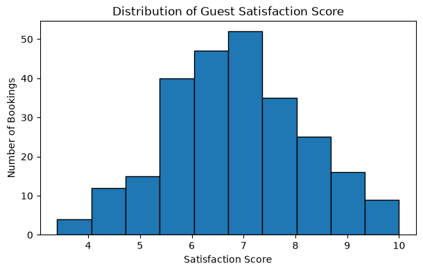
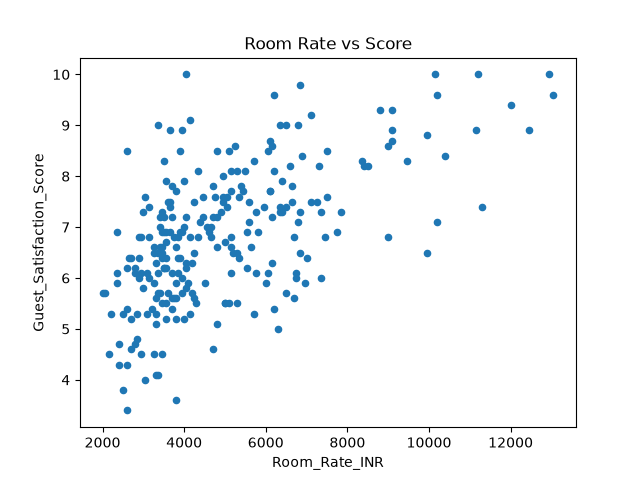
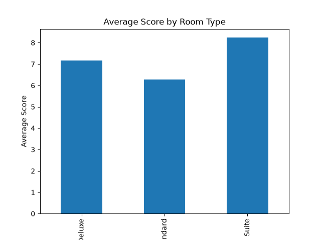
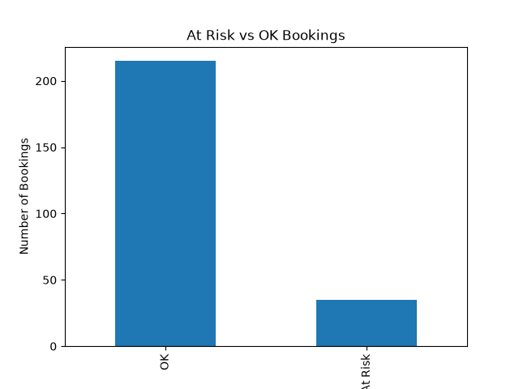

# Hotel Booking and Guest Satisfaction Analysis

**Name:** Saksham Verma
**Roll No:** 2026B01010080
**Tools:** Python, pandas, NumPy, matplotlib

## 1. Business Problem
A regional hotel chain with properties in five Indian cities wants to understand what drives guest satisfaction. The revenue manager needs to know which booking and stay factors move the satisfaction score, and which bookings are at risk of unhappy guests, so the chain can improve service and protect repeat business.

## 2. Questions
1. What does the guest satisfaction score look like overall?
2. Do `Room_Rate_INR` and `Meal_Spend_INR` affect the satisfaction score?
3. Does the score differ by `Hotel_City`, `Room_Type`, `Booking_Channel` and `Customer_Type`?
4. Which bookings need attention? (At Risk = score below 5.5)

## 3. Dataset
- Raw file: `data/raw/hotel_bookings_data.csv` (synthetic, AI-generated; 255 rows x 12 columns)
- Cleaned file: `data/processed/hotel_bookings_clean.csv` (250 rows x 15 columns)

### Data Dictionary

| Column | Data type | Meaning | Valid values / range |
|---|---|---|---|
| Booking_ID | text | Unique booking code | H1001 to H1250 |
| Hotel_City | category | City of the hotel | Mumbai, Delhi, Bengaluru, Goa, Jaipur |
| Room_Type | category | Type of room booked | Standard, Deluxe, Suite |
| Booking_Channel | category | How the booking was made | Website, Mobile_App, Travel_Agent, Walk_In |
| Customer_Type | category | Kind of guest | Individual, Family, Corporate |
| Lead_Time_Days | integer | Days between booking and check-in | 0 to 180 |
| Stay_Nights | integer | Number of nights stayed | 1 to 10 |
| Num_Guests | integer | Guests in the booking | 1 to 5 |
| Room_Rate_INR | integer | Room price per night (rupees) | about 1,500 to 14,000 |
| Meal_Spend_INR | integer | Food and beverage spend (rupees) | 0 and above |
| Check_In_Date | date | Check-in date (YYYY-MM-DD) | within the last 2 years |
| Guest_Satisfaction_Score | float | Guest rating (outcome column) | 1.0 to 10.0 |

## 4. Steps I Followed
1. **Loaded and inspected** the data with `head`, `shape`, `info`, `describe`, missing-value and duplicate counts, and `value_counts` for category columns.
2. **Cleaned the data:**
   - **Duplicates:** 5 exact duplicate rows were removed so no booking is counted twice (255 -> 250 rows).
   - **Inconsistent text:** `Hotel_City` had the same city written in different cases and with extra spaces. I stripped spaces and converted to title case, leaving exactly 5 cities.
   - **Impossible values:** `Stay_Nights` had negative values (minimum -2). A stay cannot be negative, so I treated them as missing.
   - **Missing values:** numeric columns (`Stay_Nights`, `Lead_Time_Days`, `Meal_Spend_INR`) were filled with the median, which is not pulled by extreme values. Category columns (`Customer_Type`, `Booking_Channel`) were filled with the most common value (mode).
3. **Created new columns:**
   - `Total_Room_Revenue` = `Room_Rate_INR` x `Stay_Nights`
   - `Risk_Flag` = "At Risk" if the score is below 5.5, otherwise "OK"
   - `Lead_Time_Band` = Last-minute (0-7 days), Short (8-30), Planned (31-90), Early (91-180)
4. **Analysed** each question with tables and charts (saved in `images/`).
5. **Saved** the cleaned file to `data/processed/hotel_bookings_clean.csv`.

## 5. Key Findings
- **Overall (Q1):** The average satisfaction score is about 6.83 out of 10 (median 6.8, range 3.4 to 10.0). Most guests score between 5.9 and 7.6.
- **Rate and meal spend (Q2):** Both are clearly linked to satisfaction. The correlation with `Room_Rate_INR` is about 0.59 and with `Meal_Spend_INR` about 0.54, so guests who pay more for rooms and spend more on meals tend to rate their stay higher.
- **Groups (Q3):**
  - By room type: Suite scores highest (about 8.24), then Deluxe (7.16), and Standard lowest (6.27).
  - By city: Mumbai is highest (about 7.08) and Jaipur lowest (about 6.53).
  - By booking channel and customer type, the differences are small (all averages between 6.65 and 6.95).
- **Bookings needing attention (Q4):** 35 of 250 bookings (14%) are At Risk. 30 of the 35 are Standard rooms, and about 23% of all Standard bookings are At Risk, compared with about 6% of Deluxe and 0% of Suite bookings. Delhi (11) and Mumbai (9) have the most At Risk bookings.
- **Extra:** Bookings made early (91-180 days ahead) have the highest average score (about 7.40), and last-minute bookings the lowest (about 6.52).

## 6. Charts

**Q1: Distribution of satisfaction score**

**Q2: Room rate vs satisfaction score**

**Q3: Average score by room type**

**Q4: At Risk vs OK bookings**

## 7. Recommendations
1. **Improve the Standard room experience.** Standard rooms account for most At Risk bookings, so the chain should look at room quality, amenities and service for this category first.
2. **Encourage more meal spending.** Guests who spend more on meals rate their stay higher. Offer meal packages, welcome credits or better restaurant promotion to increase meal use.
3. **Focus on Delhi and Mumbai.** These cities have the most At Risk bookings, so check service quality there, and learn from Mumbai's high average score.
4. **Promote early booking.** Early bookers score higher, so offer early-bird discounts and give extra attention to last-minute guests.

## 8. How to Run
1. Install the libraries: `pip install -r requirements.txt`
2. Open `notebooks/hotel_analysis.ipynb` and run all cells from top to bottom.

## Note
The dataset was generated with an AI assistant, as allowed in the assignment, and I got AI help with some of the code, which my teacher permitted.